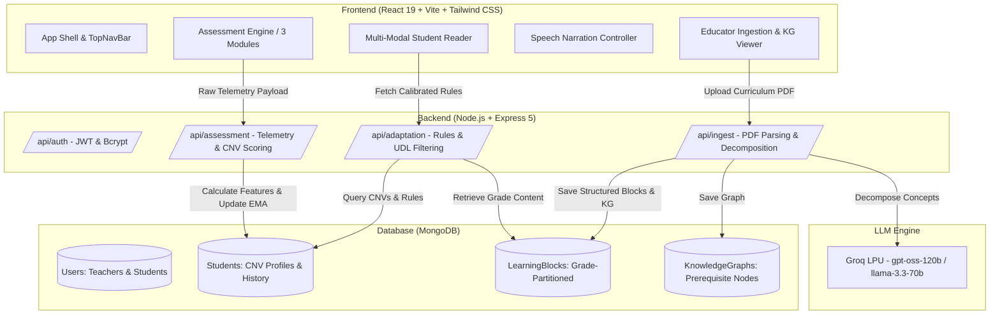

# LumynMinds 🧠✨
### Zero-Latency Adaptive Cognitive Learning Infrastructure for Neurodivergent Learners

[](https://react.dev/)
[](https://vitejs.dev/)
[](https://tailwindcss.com/)
[](https://nodejs.org/)
[](https://expressjs.com/)
[](https://www.mongodb.com/)
[](https://groq.com/)
[](#universal-design-for-learning)

> *"Imagine a textbook that reads a student's mind."*
>
> Every student's brain processes information uniquely. Standard digital textbooks force neurodivergent students into rigid, text-heavy walls of content that induce sensory overload and cognitive fatigue. **LumynMinds** continuously monitors real-time interaction telemetry, calibrates an individual 12-dimensional **Cognitive Neuro-Variability (CNV)** profile, and dynamically adapts reading support, concept chunking, layout density, typography, and multi-modal sensory presentations with zero latency.

---

## 📑 Table of Contents
1. [Core Features](#-core-features)
2. [The 12 Cognitive Neuro-Variability (CNV) Dimensions](#-the-12-cognitive-neuro-variability-cnv-dimensions)
3. [Cognitive Assessment & Calibration Engine](#-cognitive-assessment--calibration-engine)
4. [Multi-Modal Interactive Reader](#-multi-modal-interactive-reader)
5. [Educator Ingestion & Verification Portal](#-educator-ingestion--verification-portal)
6. [System Architecture](#-system-architecture)
7. [Tech Stack](#-tech-stack)
8. [Project Structure](#-project-structure)
9. [Getting Started & Local Setup](#-getting-started--local-setup)
10. [Environment Variables](#-environment-variables)
11. [API Endpoints Reference](#-api-endpoints-reference)
12. [Sensory-Safe Visual Design System](#-sensory-safe-visual-design-system)

---

## 🚀 Core Features

* **Non-Clinical Cognitive Calibration:** An engaging, 3-to-4 minute gamified micro-assessment that measures sensory vulnerability, working memory capacity, multi-modal affinity, and reward responsiveness without clinical anxiety.
* **Continuous Behavioral Telemetry:** Background logging of rapid/erratic clicks, idle freeze states, window focus blurs, and reread regressions to calculate session validity and cognitive stamina.
* **Real-Time Zero-Latency Adaptation:** Rule-derivation engine that intercepts learning blocks and dynamically activates typography scaling, summary-first layouts, single-concept focus modes, and step-by-step worked examples.
* **Universal Design for Learning (UDL 3.0):** Every concept block seamlessly adapts across four presentation modes: Multi-Modal, Visual Only, Deep Dive / Text, and Practice / Quiz.
* **Integrated Natural Speech Narration:** Built-in read-aloud voiceover engine with word-by-word tracking, adjustable speeds (0.85x, 1.0x, 1.15x), scrubable progress, and an asynchronous Chrome speech-synthesis keep-alive loop.
* **Interactive Mermaid.js Concept Graphs:** Automated visual generation of flowcharts, state transitions, and process models with robust syntax sanitization.
* **Educator-in-the-Loop Verification:** Curriculum PDF ingestion using OCR/PDF parsing, LLM-powered atomic concept decomposition (`openai/gpt-oss-120b` or LLaMA 3.3 70B via Groq), cognitive load scoring, and prerequisite knowledge graph construction.
* **Sensory-Safe Warm Organic Design:** Crafted with an earthy terracotta palette, warm parchment surfaces (`#fff8f6`), dark espresso typography (`#241914`), and soft pill buttons to eliminate visual overstimulation.

---

## 🧬 The 12 Cognitive Neuro-Variability (CNV) Dimensions

Each student's profile is quantified across 12 continuous dimensions. Each dimension has a `value` ($0.0 \to 1.0$) and a statistical `confidence` score ($0.0 \to 1.0$) updated via Exponential Moving Average (EMA):

$$\text{Value}_{\text{new}} = 0.85 \times \text{Value}_{\text{old}} + 0.15 \times \text{Session Evidence}$$
$$\text{Confidence}_{\text{new}} = \text{Confidence}_{\text{old}} + (0.20 \times \text{Session Validity})$$

| # | CNV Dimension | Behavioral Feature Source | Automated UI / Pedagogical Accommodation |
|---|---|---|---|
| 1 | **`sensory_support`** | `SensoryDegradation` (clean vs cluttered latency) | Activates `low_stimulation` theme; removes visual noise, side banners, and ambient animations. |
| 2 | **`reading_support`** | `clamp(1 - TextAffinity)` (reading dwell vs audio/visual) | Enlarges typography (`text-lg`), increases line height, renders executive summary first. |
| 3 | **`chunking_support`** | `ProcessingLag` (execution time under clutter) | Enforces strict atomic chunking, breaking long sections into single-concept micro-steps. |
| 4 | **`abstraction_support`** | `ConceptTransferDeficit` (analogical reasoning score) | Prompts generative LLM to inject real-world analogies, concrete metaphors, and everyday examples. |
| 5 | **`working_memory_support`** | `WorkingMemoryLoad` (recall errors + tab switches) | Embeds step-by-step worked examples, persistent references, and inline checkpoints. |
| 6 | **`attention_support`** | `DistractibilityIndex` (erratic clicks + idle events) | Activates single-concept Focus Mode, shielding against off-task cognitive drifting. |
| 7 | **`structure_support`** | `InitiationDelay` (hesitation time before first action) | Provides guided, predictable sequential navigation with explicit progress markers. |
| 8 | **`gamification_support`** | `MotivationalResponsiveness` (reward speedup) | Enables XP points, streak multipliers, milestone toasts, and celebration confetti. |
| 9 | **`fatigue_sensitivity`** | `PerformanceDeclineSlope` (start vs end speed) | Monitors reading dwell time and triggers periodic rest, stretch, and hydration reminders. |
| 10 | **`pace_support`** | `GlobalSpeed` (completion time relative to baseline) | Removes all countdown timers and time constraints for a self-paced, pressure-free experience. |
| 11 | **`audio_support`** | `AudioAffinity` (play count, listening ratio, completion) | Automatically surfaces and auto-expands the voice narration read-aloud player. |
| 12 | **`visual_support`** | `VisualAffinity` (diagram zooms and node interactions) | Prioritizes interactive concept diagrams, flowcharts, and spatial schematics over dense text. |

---

## 🎯 Cognitive Assessment & Calibration Engine

The assessment (`Assessment.jsx`) is structured into 3 gamified micro-modules:

```
[Student Start]
       │
       ▼
┌────────────────────────────────────────────────────────┐
│ Module 1: Visual Exploration & Sensory Load            │
│ • Phase A: Clean distraction-free text passage         │
│ • Phase B: Cluttered layout with realistic school ads  │
│ ➔ Captures: SensoryDegradation, InitiationDelay, Speed │
└──────────────────────────┬─────────────────────────────┘
                           │
                           ▼
┌────────────────────────────────────────────────────────┐
│ Module 2: Multi-Modal Intake & Working Memory          │
│ • Topic: The Synthetic "Luma Crystal" Energy System   │
│ • Student freely chooses Text, Diagram, or Audio       │
│ • 3-question recall quiz testing core system parts     │
│ ➔ Captures: Modality Affinities, WorkingMemoryLoad     │
└──────────────────────────┬─────────────────────────────┘
                           │
                           ▼
┌────────────────────────────────────────────────────────┐
│ Module 3: Reasoning, Transfer & Motivation             │
│ • Part A: Cross-domain conceptual analogies            │
│ • Part B: Fast-paced reward-accelerated symbol rounds  │
│ ➔ Captures: TransferDeficit, Dopaminergic Boost, Stamina│
└──────────────────────────┬─────────────────────────────┘
                           │
                           ▼
┌────────────────────────────────────────────────────────┐
│ Statistical Validity Filter (Threshold >= 0.35)       │
│ ➔ If valid: Updates 12 CNVs & stores in MongoDB        │
│ ➔ If rejected: Flags invalid and requests fresh retry  │
└────────────────────────────────────────────────────────┘
```

### Telemetry Formulations
* **Session Validity:**
  $$\text{Validity} = 0.35 \times \text{Completion} + 0.20 \times \max(0.4, \text{TimeScore}) + 0.25 \times (1 - \text{RandomClicks}) + 0.20 \times \text{FocusScore}$$
* **Sensory Degradation:**
  $$\text{Degradation} = \frac{t_{\text{clutter}} - t_{\text{clean}}}{\max(1, t_{\text{clean}})} + 0.05 \times \text{scrollbacks} + 0.03 \times \text{rereads}$$
* **Distractibility Index:**
  $$\text{Distractibility} = 0.25 \times \frac{\text{WrongClicks}}{10} + 0.25 \times \frac{\text{TabSwitches}}{10} + 0.25 \times \frac{\text{Idles}}{10} + 0.25 \times \frac{\text{Rereads}}{10}$$

---

## 📖 Multi-Modal Interactive Reader

The student reader (`StudentDashboard.jsx`) presents learning blocks calibrated to the student's CNV profile:
* **UDL Presentation Modes:**
  * 🎛️ **Multi-Modal:** Integrated view combining summary, audio narration, interactive diagrams, analogies, and key takeaways.
  * 👁️ **Visual Only:** Minimal prose with expanded Mermaid diagrams, structural callouts, and visual infographics.
  * 📄 **Deep Dive / Text:** Detailed textbook narrative, historical context, and deep conceptual notes.
  * ✍️ **Practice / Checkpoints:** Concept quizzes with instant validation, gentle hints, and pedagogical explanations.
* **Interactive Audio Synthesizer:** Multi-speed controller (`0.85x`, `1.0x`, `1.15x`) with progress bar and Chrome silence-interval bypass to prevent premature speech cancellation.
* **Automatic Error Recovery:** Dynamic sanitization of Mermaid flowchart labels to prevent parsing errors caused by scientific nomenclature or parentheses.

---

## 🧑‍🏫 Educator Ingestion & Verification Portal

The Educator Portal (`EducatorDashboard.jsx`) provides teachers with direct control:
* **Curriculum PDF Ingestion:** Upload NCERT, CBSE, or custom state curriculum documents.
* **Automated Concept Extraction:** Uses Groq's high-speed inference engine (`openai/gpt-oss-120b`) to extract:
  * Atomic Learning Blocks (Summary, Deep Dive, Key Takeaways, Analogies).
  * Cognitive Load ($1.0 \to 5.0$) and Difficulty metrics.
  * Prerequisite concepts for automated Knowledge Graph construction.
  * Multi-level concept verification quizzes.
* **Grade-Level Isolation:** Curriculums and blocks are automatically tagged by grade (e.g., Grade 9, Grade 10) so students receive strictly age-appropriate content.
* **Live Telemetry & Analytics:** Educators can review cohort-level CNV distributions, average validity scores, and individual student accommodation requirements.

---

## 🏗️ System Architecture



---

## 💻 Tech Stack

### Frontend
* **Core:** React 19, Vite 8, React Router v7
* **Styling:** Tailwind CSS v3.4 (with customized warm organic tokens)
* **Visuals & Charts:** Mermaid.js 11.15, Lucide React icons
* **Typesetting & Math:** KaTeX 0.16
* **Audio Synthesis:** Web Speech API (`SpeechSynthesisUtterance`) with keep-alive buffer

### Backend
* **Runtime:** Node.js 18+ & Express.js 5.2
* **Database:** MongoDB with Mongoose 9.6
* **Authentication:** JSON Web Tokens (`jsonwebtoken`) & `bcryptjs`
* **File Processing:** Multer, `pdf-parse-new`
* **AI & LLM:** Groq SDK (`groq-sdk` v1.2) utilizing `openai/gpt-oss-120b`

---

## 📂 Project Structure

```
LumynMinds/
└── lumynminds/
    ├── backend/
    │   ├── config/
    │   │   └── db.js                 # MongoDB connection handler
    │   ├── models/
    │   │   ├── User.js               # Educator & student accounts
    │   │   ├── Student.js            # 12-dimensional CNV profile & history
    │   │   ├── LearningBlock.js      # Multi-modal atomic concept lessons
    │   │   └── KnowledgeGraph.js     # Prerequisite nodes & connections
    │   ├── routes/
    │   │   ├── auth.js               # Login & registration endpoints
    │   │   ├── assessment.js         # Telemetry intake, feature extraction, CNV scoring
    │   │   ├── adaptation.js         # UDL rule derivation & grade-filtered block delivery
    │   │   └── ingest.js             # PDF upload, OCR text extraction, Groq LLM prompt
    │   ├── package.json
    │   ├── server.js                 # Express server bootstrap & middleware
    │   └── .env                      # Server environment configuration
    └── frontend/
        ├── public/
        │   └── vite.svg
        ├── src/
        │   ├── assets/
        │   │   ├── logo.png          # Terracotta brand logo
        │   │   └── hero-children-*.png
        │   ├── components/
        │   │   ├── TopNavBar.jsx     # Navigation shell with pill actions
        │   │   ├── HeroSection.jsx   # Hero banner with terracotta palette
        │   │   ├── TrustBanner.jsx   # UDL principles & trust proofpoints
        │   │   ├── FeatureSections.jsx
        │   │   ├── Assessment.jsx    # Complete 3-module cognitive calibration engine
        │   │   ├── StudentDashboard.jsx # Adaptive textbook reader & student home
        │   │   ├── EducatorDashboard.jsx# Curriculum upload & KG visualizer
        │   │   ├── StudentAuth.jsx   # Student login / registration modal
        │   │   ├── EducatorAuth.jsx  # Educator login / registration modal
        │   │   ├── FileUpload.jsx    # Drag-and-drop curriculum upload component
        │   │   ├── PastMaterials.jsx # Curriculum archive and review component
        │   │   └── Footer.jsx        # Warm espresso footer
        │   ├── App.jsx               # View router, auth state, and scroll-to-top logic
        │   ├── index.css             # Base CSS and font declarations
        │   └── main.jsx              # React DOM mounting
        ├── tailwind.config.js        # Warm terracotta design tokens, border radii, shadows
        ├── package.json
        └── vite.config.js            # Vite build configuration
```

---

## ⚙️ Getting Started & Local Setup

### Prerequisites
1. **Node.js** v18.0.0 or higher ([Download Node.js](https://nodejs.org/))
2. **MongoDB** Community Server v6+ or MongoDB Atlas ([Download MongoDB](https://www.mongodb.com/try/download/community))
3. **Groq API Key** ([Get a Free Groq Key](https://console.groq.com/keys))

---

### 1. Clone the Repository
```bash
git clone https://github.com/Krish-jswl/lumynminds.git
cd lumynminds
git checkout Shriyanshu
```

---

### 2. Configure Backend
```bash
cd lumynminds/backend
npm install
```

Create a `.env` file in `lumynminds/backend`:
```env
# Server Port
PORT=5000

# MongoDB Connection String (Local or Atlas)
MONGO_URI=mongodb://127.0.0.1:27017/lumynminds

# JWT Secret for Session Auth
JWT_SECRET=your_super_secret_jwt_key_here

# Groq API Key for Curriculum Ingestion
GROQ_API_KEY=gsk_your_groq_api_key_here
```

Start the backend development server:
```bash
npm run dev
# Server will run at: http://localhost:5000
```

---

### 3. Configure Frontend
Open a second terminal window:
```bash
cd lumynminds/frontend
npm install
```

Start the Vite frontend development server:
```bash
npm run dev
# Web application will run at: http://localhost:5173
```

---

### 4. Build for Production
To verify and create an optimized production build:
```bash
cd lumynminds/frontend
npm run build
```

---

## 🔑 Environment Variables

| Variable | Description | Example Default |
|---|---|---|
| `PORT` | Express HTTP server port | `5000` |
| `MONGO_URI` | MongoDB connection URI | `mongodb://127.0.0.1:27017/lumynminds` |
| `JWT_SECRET` | Secret token used to sign auth JWTs | `secret_key_123` |
| `GROQ_API_KEY`| Authentication token for Groq LPU inference | `gsk_...` |

---

## 📡 API Endpoints Reference

### 1. Authentication (`/api/auth`)
* `POST /api/auth/teacher/register` — Create a new educator account.
* `POST /api/auth/teacher/login` — Authenticate educator & return JWT.
* `POST /api/auth/student/register` — Register a student account with grade.
* `POST /api/auth/student/login` — Authenticate student & check assessment status.

### 2. Cognitive Assessment (`/api/assessment`)
* `POST /api/assessment/evaluate` — Ingest raw behavioral telemetry from Modules 1–3, calculate Validity and 14 behavioral features, update the 12-dimensional CNV profile, and persist to MongoDB.
* `GET /api/assessment/test` — Health check endpoint.

### 3. Real-Time Adaptation (`/api/adaptation`)
* `GET /api/adaptation/rules/:studentId` — Computes active UI rules (theme, chunking, typography, audio, focus mode, checkpoints) based on CNVs.
* `GET /api/adaptation/blocks/:studentId` — Returns atomic learning blocks filtered by the student's calibrated grade level.
* `GET /api/adaptation/student-status/:studentId` — Checks if a student needs to take an initial calibration assessment.

### 4. Curriculum Ingestion (`/api/ingest`)
* `POST /api/ingest/upload` — Accepts multi-part PDF curriculum upload, executes OCR text extraction, calls Groq LLM for atomic concept decomposition, and builds knowledge graph relationships.
* `GET /api/ingest/past-materials` — Retrieves previously processed curriculum documents and block counts.

---

## 🎨 Sensory-Safe Visual Design System

LumynMinds follows a neurodivergent-friendly visual language inspired by warm organic parchment tones:

* **Background Surfaces:** `#fff8f6` (Warm Parchment Base) and `#fff1eb` (Surface Container Low).
* **Primary Accents:** Terracotta Orange (`#f97d36`, hover `#ea580c`).
* **Headings:** Deep Espresso (`#241914`, high contrast without harsh black-on-white glare).
* **Body Text:** Warm Mocha (`#574238`, optimized for low visual fatigue).
* **Interactive Elements:** Generous `rounded-full` pill buttons and soft `rounded-3xl` card containers.
* **Low Stimulation Mode:** Automatically triggered for high sensory support learners, eliminating extraneous animations, lowering border contrasts, and prioritizing muted earth tones.

---

## 🤝 Contributing & Team

* **Krish Jaiswal** — Core Architecture & Infrastructure
* **Shriyanshu Kumar Kapsime** — Cognitive Calibration Engine, Adaptation & Frontend UX

---

## 📄 License

This project is licensed under the ISC License. See the `LICENSE` file for details.
